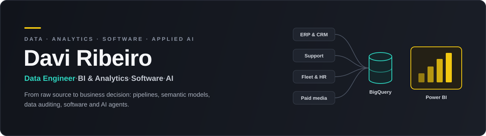
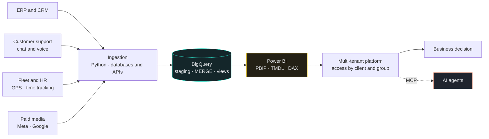

<!-- Profile README: Davi Ribeiro (@DaviFRibeiro) -->

  

  
  
  
  

---

## About

I'm a data engineer who works across the **whole process**: I start from the business question, find where the data actually lives, build the pipeline, model it, ship the dashboard, and stay until the numbers hold up.

A big part of my day is **making numbers trustworthy**. When a report disagrees with the source system, I trace the rule, the row and the origin until the gap is explained, then fix it in the right layer: first the pipeline and warehouse, then the model and measures, and only then the visual.

I also **build software around data**: the multi-tenant platform where clients access their reports, and an MCP server that lets AI agents work on it within defined limits.

Today I do this at **Delipe**, mostly for telecom companies, across sales, finance, marketing, customer support, field operations, inventory, networks and HR. The domains change; the process doesn't.

---

## What I Build

<table>
  <tr>
    <td width="33%" valign="top">
      <b>🔀 Data Pipelines</b> 
      Incremental ETL from databases and APIs into the warehouse, scheduled and repeatable.
    </td>
    <td width="33%" valign="top">
      <b>📊 Data Modeling & BI</b> 
      Semantic models and dashboards as code: Power BI PBIP, TMDL and DAX, versioned in Git.
    </td>
    <td width="33%" valign="top">
      <b>🔎 Data Quality & Auditing</b> 
      When numbers disagree, I trace rule, row and source until the gap is explained.
    </td>
  </tr>
  <tr>
    <td valign="top">
      <b>📈 Business Analytics</b> 
      Churn risk, cohorts, delinquency, marketing funnels and CAC, field productivity.
    </td>
    <td valign="top">
      <b>🧩 Data Products</b> 
      Multi-tenant platforms: per-group and per-user access, embedded reports, onboarding flows.
    </td>
    <td valign="top">
      <b>🤖 Applied AI</b> 
      MCP servers and coding agents with OAuth, scopes and audit trails, doing real work.
    </td>
  </tr>
</table>

---

## Tech Stack

> The tools behind the work listed below.

**Languages**

  
  
  
  
  

**Data & BI**

  
  
  
  
  
  

**Platform & APIs**

  
  
  
  
  
  

**Infrastructure**

  
  
  
  
  

**Integrations & AI**

  
  

---

## Featured Work

> Production work at Delipe. The code is private, so I describe the problem and my part. Clients and client data stay out.

| # | Work | What it solves | Stack |
|---|------|----------------|-------|
| 1 | **Multi-source ETL** | Pipelines loading several ERPs into BigQuery for dozens of client companies, with per-client YAML config and global rules wherever possible | Python · SQL · BigQuery · systemd |
| 2 | **API and database connectors** | 10+ connectors built from scratch for ERPs, contact-center platforms (including Genesys Cloud) and fleet GPS trackers. Many share a common contract, so the same report can serve different platforms | Python · REST APIs · BigQuery |
| 3 | **Marketing-to-sales attribution** | Links ad, conversation and sale (Meta Ads, Google Ads, chat and ERP, matched by phone and tax ID) to measure funnel and CAC | Python · SQL · Power BI |
| 4 | **BI product modules** | Contracts, finance, field productivity and network analytics: churn risk, network occupancy, field time measured by GPS | PBIP · TMDL · DAX · BigQuery |
| 5 | **MCP server for AI agents** | Agents read, analyze, create and edit platform data, but can never delete it or trigger sends. OAuth 2.1, scopes and audit trail | TypeScript · Fastify · MCP |
| 6 | **Data platform access control** | Per-employee access, per-group allowlists of Power BI pages, and client onboarding that creates the CRM task | TypeScript · Fastify · React · Power BI Embedded |
| 7 | **Multi-agent coding workspace** | Internal fork of [Alethe](https://github.com/Kc1t/alethe-agents) with an SSH workflow, per-project default terminal and BigQuery queries inside the app | TypeScript |

---

## Public Projects

| Project | What it shows | Stack |
|---------|---------------|-------|
| **[veiculos_api](https://github.com/DaviFRibeiro/veiculos_api)** | REST API with JWT authentication, Redis cache, live USD/BRL conversion and tests | FastAPI · PostgreSQL · Redis · Docker · pytest |
| **[Desafio-Cites-Brigth](https://github.com/DaviFRibeiro/Desafio-Cites-Brigth)** | Automated collection of public-safety spreadsheets (SSP-SP) followed by data analysis | Python · Selenium · pandas |
| **[Currency-converter](https://github.com/DaviFRibeiro/Currency-converter)** | Desktop currency converter with live rates and a history chart | Python · CustomTkinter |
| **[Auto](https://github.com/DaviFRibeiro/Auto)** | Desktop automation that opens a sequence of apps with one click | Python · PyAutoGUI · Tkinter |
| **[portifolio_dr](https://github.com/DaviFRibeiro/portifolio_dr)** | Responsive personal portfolio | HTML · JavaScript · Tailwind CSS |

---

## How I Work

**From source to decision**

**From request to delivery**

**Request → business rule** (metric, grain, date) **→ ETL and warehouse → model and measures → visuals → check against the source → publish.** If the numbers don't match, I trace the gap and go back to the rule.

---

## Engineering Principles

| Principle | In practice |
|-----------|-------------|
| **Understand before building** | Business rule, metric, grain and date filter come before code. |
| **Start from the foundation** | Pipeline, model, measures, and only then visuals. |
| **Global before local** | Does this solve one client, or does it improve the product? |
| **Numbers must match** | "Done" means validated against the source. |
| **Read-only at the source** | Only `SELECT` on client production databases. |
| **Cost is a requirement** | New fact tables start incremental, with partitioning decided and documented. |
| **Sensitive data with care** | Personal data and credentials only when the task needs them, never in logs or summaries. |
| **AI with limits** | Agents have scopes and audit trails, and what they can't do is enforced in code. |

---

## Current Focus

  
  
  
  

Right now: tracing marketing from ad to sale, measuring field productivity by crossing work orders with GPS, row-level security by branch, and AI agents that do real work within clear limits.

---

ℹ️ Almost all of my work lives in private repositories under another account, so this profile's contribution graph doesn't show the real volume. Clients and client data never appear here.
